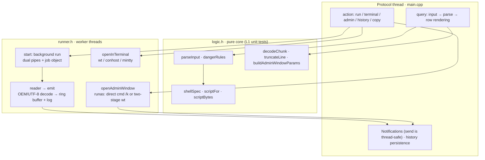

# Contributing to ra9fael.shell

Thanks for helping. Bug reports, ideas and pull requests are all welcome.
Chinese version: [CONTRIBUTING.md](CONTRIBUTING.md).

## Reporting a bug

Open an issue with:

- the plugin version (Win顺 → Settings → Plugins → Installed) and your Win顺
  version,
- the Windows version and which shells you have (cmd / pwsh / Git Bash /
  MSYS2 / WSL),
- what you typed or did, what you expected, and what happened,
- the plugin's messages from Win顺's message log, if any.

Remove anything private (paths with your user name, host names, IPs,
environment values) before posting.

## Development setup

- Windows 10/11 x64.
- CMake 3.21+ and a C++17 compiler: Visual Studio 2022 or later (MSVC) or
  MinGW-w64 GCC 13+.
- Python 3.10+ for `tools/package.py` (standard library only).
- Win顺 itself, to try the plugin.

```powershell
cmake -S . -B build -A x64                 # MSVC; for MinGW use -G "MinGW Makefiles"
cmake --build build --config Release       # writes shell.exe next to plugin.json
ctest --test-dir build -C Release --output-on-failure
```

To run your build inside Win顺, link the repository into Win顺's plugin folder
instead of installing a copy (adding a folder through the settings page copies
it, so later builds would not reach Win顺):

```powershell
New-Item -ItemType Junction -Path "$env:LOCALAPPDATA\WinShun\plugins\ra9fael.shell" -Target (Get-Location)
```

Then enable the plugin in **Settings → Plugins → Installed**. Win顺 refuses to
replace a junction when you install a package of the same id, so remove the
link before installing a package. **Do not uninstall a linked plugin from the
settings page**: uninstall removes the folder recursively and has no junction
check, so it can delete the files in your clone. Remove the link itself with
`cmd /c rmdir "$env:LOCALAPPDATA\WinShun\plugins\ra9fael.shell"` (this deletes
only the junction). A running `shell.exe` is locked; rename it (for example to
`shell.exe.old`) before rebuilding, and Win顺 restarts the plugin with the new
exe. Remove an installed non-linked copy of the same id first.

`winshun.h` is a byte-for-byte copy of the Win顺 SDK header
(`WinShun/src/plugins-sdk/winshun.h`). Do not edit it here; update it from
upstream as a separate commit.

## Code map

| File | Responsibility |
|---|---|
| `winshun.h` | The Win顺 SDK header: protocol and host contract (do not edit) |
| `logic.h` | **Pure core**: input parsing, shell detection and script generation, output decode/cleaning, danger rules, history, cap truncation, the admin window wrapper — no Win32; all unit tests live here |
| `runner.h` | **Runtime**: `RunManager` (background runs' dual pipes / job object / ring buffer / log), `openInTerminal` (Ctrl+Enter's wt/conhost/mintty), `openAdminWindow` (the elevated window: direct or two-stage into WT) |
| `main.cpp` | **Plugin glue**: protocol loop, query→row rendering, action dispatch, settings, notifications, history persistence |
| `tests/test_logic.cpp` | Unit tests for logic.h (`ctest` runs `shell_tests`) |
| `tools/package.py` | Packs `dist/<id>-<version>.wsplugin` (deterministic zip) |

Threading model: the protocol thread only assembles strings and registers
state, and never waits on a child; anything that blocks (reading pipes, the
UAC secure desktop) runs on worker threads. A query held too long three times
gets the plugin hang-restarted by the host — that is the first constraint
behind every threading decision.



The three execution paths; and the full sequence of the admin path (UAC
blocking the worker, the window owning the process, results not returning to
the list):

```mermaid
sequenceDiagram
    participant U as User
    participant P as Plugin (protocol thread)
    participant W as Worker thread
    participant C as System32 cmd.exe
    participant T as wt / console window
    U->>P: Ctrl+Shift+Enter (executeAdmin)
    P->>P: guards: adminMode · adminCapable · m_adminBusy
    P->>W: spawn thread, return keep at once
    W->>W: write script runs\t<tick>.cmd|.ps1 → fnv1a64 re-read check (one rewrite retry)
    W->>C: ShellExecuteExW(runas, /d /s /k|/c …), blocked under the secure desktop
    C->>U: UAC dialog
    alt declined (1223)
        W->>U: notify "UAC declined; nothing ran"; no history
    else consented
        C->>T: two-stage: /c launches wt.exe then exits<br/>direct: /k hosts the payload itself
        W->>U: notify "Opened in an admin window"; history recorded (exit code unknown)
    end
    W->>W: m_adminBusy = false
```

## Tests

- `ctest` runs `shell_tests`: pure functions from `logic.h` only (input
  parsing, custom shell parsing, script generation, WSL path conversion,
  output decoding, danger rules, history, cleanup, the admin window wrapper
  and `wtEscape`, output-line truncation, setting-value fallbacks). No
  processes are started and no system state is needed; any C++17 compiler
  runs them.
- Integration tests drive the stdio protocol against real shells (the scripts
  are described in the test-plan section of `shell-plugin-design.md`). After
  touching the runner, shell detection or the protocol glue, at least run the
  cmd / pwsh / bash execution, cancel and clipboard-confirmation scenarios and
  record the results in §9 of the design document.

The layering convention (details in both design docs' test-plan sections):

| Layer | Content | Where |
|---|---|---|
| L0 | plugin.json schema (validated at load) | wsbench / WinShun |
| L1 | logic.h pure functions | `ctest`, any platform |
| L2 | dedicated probes (an admin-elevation probe existed; retired with the window model) | as needed |
| L3 | real host: wsbench drives query/action/settings round trips; **never triggers executeAdmin** (a real UAC) | wsbench |
| L4 | real machine, manual: real UAC, window behavior, notification clicks | maintainer |
| L5 | release: `tools/package.py --tag` | at release |

## Pull requests

1. Fork, create a branch from `main`.
2. Keep a pull request to one topic. Follow the existing style: C++17, no
   third-party libraries, no runtime DLLs, all code and comments in English.
   Documentation is bilingual (see "Documentation languages"). User-facing
   strings in plugin.json stay bilingual zh/en.
3. Add or update unit tests for logic changes. Behavioural changes to
   integration paths must be verified against real shells.
4. Before opening the PR, run at least once in Win顺: a typed command, a
   clipboard run, and Ctrl+Enter.
5. If behaviour, settings or permissions change, update **both** `README.md`
   and `README.en.md`, and add a line under `## [Unreleased]` in both
   `CHANGELOG.md` and `CHANGELOG.en.md`.
6. Commit messages use the Angular convention
   ([Conventional Commits](https://www.conventionalcommits.org/)):
   `type(scope): imperative summary`, a blank line, then the body. Allowed
   types: `feat`, `fix`, `docs`, `style`, `refactor`, `perf`, `test`, `build`,
   `ci`, `chore`, `revert`; scopes are module names: `logic`, `shell`
   (detection and launch parameters), `runner`, `clipboard`, `history`,
   `manifest`, `readme`, `design`. Lowercase summary, no trailing period.
   Breaking changes add `!` after the type, e.g. `feat(logic)!: …`.

Do not commit `shell.exe`, `build/` or `dist/`; `.gitignore` already excludes
them.

### Permissions

Adding or widening a permission in `plugin.json` needs a reason in the PR and
in the README's permissions section. Win顺 asks users to confirm permissions
again when they change, so keep them minimal.

## Documentation languages

Win顺 is Chinese-first but also ships an English UI, so the user-facing
documentation follows the same split. §12.3 of the design document
(`shell-plugin-design.md` / `shell-plugin-design.en.md`) sets the rules:

| File | Language | Role |
|---|---|---|
| `README.md` / `CHANGELOG.md` / `CONTRIBUTING.md` | 简体中文 | Default |
| `README.en.md` / `CHANGELOG.en.md` / `CONTRIBUTING.en.md` | English | Full counterpart |

Each document starts with a language switch under the title and ends with one,
so readers can jump in either direction. **Keep both in sync**: any change to
structure, settings, permissions or install steps must be applied to both in
the same PR. Code identifiers, settings keys, command syntax, JSON and paths
stay in English in both files. The English files use Win顺's real English UI
labels (`Settings → Plugins → Installed → Add plugin → Archive
(.zip / .wsplugin)`), the Chinese ones use the Chinese labels.

`LICENSE` exists in English only.

## Releasing (maintainers)

The version in `plugin.json` is the single source of truth. Versions follow
[Semantic Versioning](https://semver.org/).

1. Bump `version` in `plugin.json` and anything that echoes it in the code.
2. Rename `## [Unreleased]` to `## [x.y.z] - YYYY-MM-DD` in both
   `CHANGELOG.md` and `CHANGELOG.en.md`, add a fresh empty `## [Unreleased]`
   above it, and update the links at the end of both files.
3. Check locally:
   ```powershell
   cmake --build build --config Release
   ctest --test-dir build -C Release --output-on-failure
   python tools/package.py --tag vx.y.z
   ```
   then install `dist/ra9fael.shell-x.y.z.wsplugin` into Win顺 from the
   archive and try it.
4. Commit (`chore(release): vx.y.z`), tag and push:
   ```powershell
   git tag -a vx.y.z -m "vx.y.z"
   git push origin main vx.y.z
   ```
5. Upload the `.wsplugin` and its `.sha256` to the GitHub Release. Never
   replace the assets of a published release; publish a new patch version
   instead.

## License

By contributing you agree that your contribution is licensed under the MIT
license of this repository.
