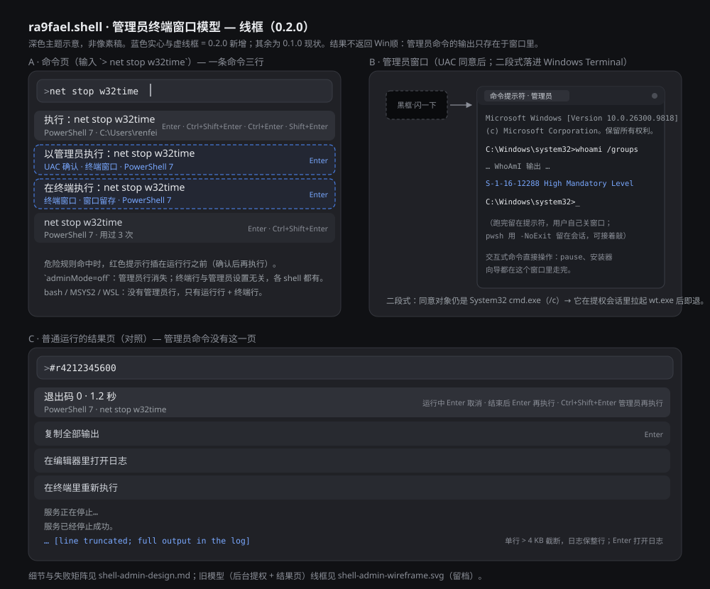
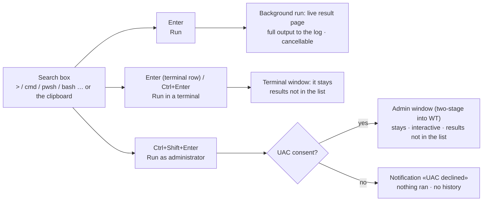

# Quick Shell (`ra9fael.shell`)

> **English** · [简体中文（默认）](README.md)
>
> Win顺 (WinShun) is Chinese-first but also ships an English UI, so the
> Chinese documentation lives in `README.md` and this English counterpart in
> `README.en.md`. The two stay in sync and link to each other.

Run shell commands from the Win顺 search box: typed by hand, or taken straight
from the clipboard. Supports cmd, PowerShell 7, Git Bash, MSYS2, WSL and custom
shells. Commands run in the background and their output refreshes live in the
result list; Ctrl+Enter runs the same command in a terminal; cmd and PowerShell
commands can also run as administrator after a UAC confirmation
(Ctrl+Shift+Enter). The plugin is a C++ resident exe with no window of its own.



## Install

1. Download `ra9fael.shell-<version>.wsplugin` from the
   [latest Release](https://github.com/ra9fael/winshun-shell/releases/latest).
   Optionally verify the SHA-256 with the `.sha256` file next to it
   (`Get-FileHash <file> -Algorithm SHA256`).
2. In Win顺, open **Settings → Plugins → Installed → Add plugin →
   Archive (.zip / .wsplugin)** and pick the file.
3. Plugins installed from a local archive are **not enabled automatically**.
   Turn the plugin on in the list; enabling it is your confirmation of the
   permissions it asks for (see [Permissions and data](#permissions-and-data)).

This plugin is a native exe package. Since Win顺 0.22.0 the plugin index
admits community exe packages as **unreviewed native plugins**
(`unreviewed-native`), so it needs Win顺 0.22.0 or newer (declared by
`minWinShun` in the manifest); installing and every update ask for
confirmation.

**Update:** install the new `.wsplugin` the same way. Win顺 recognises the id,
asks before replacing the old version, and keeps the plugin's data folder.

**Uninstall:** remove the plugin under **Settings → Plugins → Installed**.
Uninstalling ends the plugin process and its children; commands still running
in the background are terminated with it.

This plugin is a native exe, so it never appears in Win顺's in-app plugin
library (the community index only lists script plugins). The Releases page of
this repository is the only distribution channel.

## Build from source

Requirements: Windows 10/11 x64, CMake 3.21+, and either Visual Studio 2022 or
later (MSVC) or MinGW-w64 GCC 13+. Packaging needs Python 3.10+.

```powershell
cmake -S . -B build -A x64                 # MSVC; MinGW: -G "MinGW Makefiles"
cmake --build build --config Release       # writes shell.exe next to plugin.json
ctest --test-dir build -C Release --output-on-failure
python tools/package.py                    # dist/ra9fael.shell-<version>.wsplugin
```

How to run your build inside Win顺, plus the test and release process, is in
[CONTRIBUTING.md](CONTRIBUTING.md).

## Commands

One keyword per shell. Add a space after the keyword to enter keyword mode,
then type the command.

| Keyword | Example | Shell |
|---|---|---|
| `>` | `> git status` | Default shell (the `defaultShell` setting; `auto` tries pwsh → PowerShell 5.1 → cmd) |
| `cmd` | `cmd dir` | cmd (`%ComSpec%`) |
| `pwsh` | `pwsh Get-Process` | PowerShell 7 |
| `bash` | `bash ls -la` | Git Bash |
| `msys` | `msys uname -a` | MSYS2 (the `msysRoot` and `msysEnv` settings) |
| `wsl` | `wsl uname -a` | Default WSL distribution |

### `>` extras

| Input | Effect |
|---|---|
| `> ls -la` | Run with the default shell |
| `> @` | List every available shell, including custom ones |
| `> @nu ls` | Run `ls` with the custom shell `nu` |
| `> #` | Result page of the most recent run; `> #r42` selects a specific one |
| `> ` (space only) | ① Open a terminal with the default shell; ② run the clipboard content; ③ running and just-finished commands; ④ history (records from all shells, each labelled with its shell) |

`cmd #`, `bash #` and the other keywords support `#` / `#r42` the same way.
`#` is a comment in bash and pwsh, so running it alone is meaningless — it
never collides with a real command.

Pressing Enter on a history entry runs it with the shell it was recorded
with. Commands run from the clipboard are not recorded by default (the
`saveHistory` setting).

### Clipboard execution and confirmation

After the keyword plus a space, when the clipboard holds text (non-empty, up to
64 KB), a "run clipboard content" row appears with a full-text hover preview.
The first Enter **does not run** it; the list is replaced by a confirmation
page: a confirm row, a preview of the content (up to 20 lines) and — when a
danger rule matched — a warning row in front. A second Enter runs it.

The `clipboardConfirm` setting picks the confirmation point: `always`
(default), `multiline` (only many lines or a matched rule), `never`. Commands
typed by hand need no confirmation; Enter runs them directly.

**Danger rules only warn, they never block.** The plugin makes no judgement
about whether a command is safe:

- Download-and-run: `iex`, `Invoke-Expression`, `| sh`, `| bash`, `curl … |`,
  `iwr … |`
- Deletion and formatting: `rm -rf`, `Remove-Item -Recurse`, `del /s`,
  `rd /s`, `format`, `diskpart`
- System changes: `reg delete`, `bcdedit`, `Set-ExecutionPolicy`
- Invisible characters (zero-width, direction-override like `U+202E`, control
  characters): the confirmation page renders them as `<U+202E>`, so a tampered
  "copy this command" snippet is visible at a glance.

### Custom shells

The `customShells` setting is one line of text, entries split by `|`:

```text
nu = C:\tools\nu\nu.exe -f {script} | py = py -3 - ;ext=.py
```

- `name=program args…`; in the arguments `{script}` is the script path and
  `;ext=.xx` sets the script extension.
- The program must be an **existing absolute path**; the plugin never loads a
  program from its data folder.

### Run as administrator

The command pages for cmd and PowerShell 7 / 5.1 gain two entries (neither
appears when the `adminMode` setting is `off`; Git Bash, MSYS2, WSL and custom
shells have none):

- The run row's action bar gains **Ctrl+Shift+Enter — run as administrator**;
- A standalone row below it, "Run as administrator: <command>" (subtitle
  `UAC prompt · terminal window · <shell>`), triggered with plain **Enter** so
  it is reachable from the keyboard alone; history rows carry Ctrl+Shift+Enter
  as well.

Triggering it opens one UAC prompt whose consent object is always the
system's own `C:\Windows\System32\cmd.exe` — the command text never enters
the command line but lives in a script file. After consent a **visible admin
terminal window** opens: the output is in the window, stdin is real, and the
window stays after the command finishes (cmd at the prompt, PowerShell in the
session via `-NoExit`); interactive commands (`pause`, installer wizards) are
operated right there. Results do **not** return to WinShun — no result page,
no log file; the plugin only sends a notification reporting opened / declined
/ failed. The plugin does not declare the `elevated` permission and the host
never elevates on the plugin's behalf; the UAC click is always yours.

Why a window: an elevated process cannot join the plugin's job, cannot be
cancelled, and the plugin itself may be reclaimed by the host at any time
(idle, slot eviction, crash kill) — any machinery that "brings results back to
the list" is unreliable. The window owns the process: it keeps running when
WinShun exits, and the whole class of problems disappears. The cost is that
output cannot be copied/searched from the plugin and the exit code does not
enter history — commands that need admin are more naturally done in a window
anyway.

What hosts the admin window is the `adminTerminal` setting (default `auto`
follows `terminal`; `wt` always tries the two-stage form, `conhost` always
direct). The OS-level "default terminal application" setting does not help —
it applies to normal-privilege consoles, while **an elevated window is still
hosted by conhost** (measured 2026-11-08: an elevated cmd from Task Manager
behaves the same). So the two-stage start into Windows Terminal only happens
when `adminTerminal` resolves to wt: the consent object is still System32
cmd.exe, but with `/c` — the elevated cmd launches wt.exe in its session and
exits at once, leaving only the WT window; the cost is a brief flash of the
outer black box. When the two-stage form is not taken (`conhost`, a
non-wt `terminal`, or wt not installed), the elevated cmd hosts the payload
in its own (conhost) console — still visible and still staying.

Limits (by design, not bugs):

- **One UAC flow at a time.** Triggering another admin run while the prompt is
  unanswered only notifies "an admin permission request is already pending";
  once open, windows are independent and several may coexist.
- Declining the UAC prompt: a notification "UAC declined; nothing ran". A
  failed elevation (for example a system policy that disables UAC prompts):
  "Cannot elevate (error N)". Neither ran anything, neither reaches history.
- An admin window does **not** die with WinShun; it finishes and stays there
  for you to close.
- A successfully opened window reaches history (with `saveHistory` on); the
  exit code is unknown and is not shown.

## Actions

Actions are declared in a fixed order; the keyboard mapping follows the
**order**, not the `key` string.

| Command | Enter | Ctrl+Shift+Enter | Ctrl+Enter | Shift+Enter | Menu (no key) |
|---|---|---|---|---|---|
| All commands | `execute` — run in the background, results in the list | `executeAdmin` — run as administrator after a UAC prompt (cmd / PowerShell only; absent when `adminMode=off`) | `openTerminal` — run in a terminal, window stays open | `edit` — put the command back in the search box for editing | `copyCommand` — copy the command; `deleteHistory` — delete from history |

Interactive commands (`python`, `ssh`, `vim`, anything asking for a password)
go through Ctrl+Enter: a terminal opens, the script runs in place, the window
stays, and interaction is yours inside that terminal. Commands needing admin
rights go through Ctrl+Shift+Enter (see above), or get elevated by you inside
a terminal the same way. Below the run row there is also a standalone row,
"**Run in a terminal: <command>**" (subtitle `Terminal window · it stays ·
<shell>`), reachable with plain **Enter** for every shell — the same
capability as Ctrl+Enter.

The three execution paths at a glance:



## Running and results

- **Queries never execute anything** — only the Enter / Ctrl+Enter actions do.
  Typing, browsing history and reading the clipboard are side-effect free.
- After Enter the search box becomes a result-page address like `> #r42` with
  live refreshing output; the selected row never jumps.
- The result page shows the last 50 output lines (the `outputLines` setting,
  10–190). stdout and stderr are interleaved in time order, stderr rows carry
  a different icon. ANSI colour codes are stripped and a `\r` progress bar
  keeps only its last frame.
- The full output goes to a log file; Enter on the truncation row opens it.
  On the status row, Enter cancels while running (the whole process tree
  dies) and re-runs after completion.
- Action rows sit right under the status row, **before** the output lines:
  `Copy all output` · `Open log in editor` · `Re-run in terminal` ·
  `Add to history` (only on result pages of clipboard runs) — no need to
  scroll to the end of long output to reach them.
- At most 4 commands run concurrently; a further start reports the limit.
  Admin windows do not take a slot (the window owns the process); UAC requests
  are one at a time. After Esc collapses the search box the command keeps
  running and sends a system notification when done (the body names only the
  exit code and duration, never the command or output).
- Memory is bounded: only the newest 50 finished runs stay in RAM; a line over
  4 KB is truncated in the list (the log keeps it whole); a single newline-less
  output cannot grow the read buffer without limit. The plugin is resident and
  never idles out, so these caps keep the host from killing it over memory or
  an over-long output line.
- **Encoding**: each line is tried as UTF-8 first; lines that fail fall back
  to the system OEM code page. `wsl.exe`'s own errors are UTF-16LE and decode
  too.
- Every command is written to a script file and handed to the shell (no
  `-c "..."`, so quotes, `%`, `$` and `!` cannot be broken by escaping; a
  multi-line clipboard script runs as-is). cmd scripts are UTF-8 + CRLF +
  `chcp 65001`; bash-family scripts are UTF-8 without BOM + LF; PowerShell
  5.1 scripts carry a BOM. Background scripts are deleted when the run ends;
  terminal and admin-window scripts (`t<timestamp>.<ext>`) are kept and cleaned
  up with the logs.

## Settings

| Key | Type | Default | Meaning |
|---|---|---|---|
| `defaultShell` | text | `auto` | Shell for `>`: `auto`, a name from the table above, or a custom shell's name |
| `workDir` | folder | empty (user home) | Directory each run starts in |
| `pwshPath` | file | empty (auto-detect) | Full path to pwsh.exe |
| `gitBashPath` | file | empty (auto-detect) | Git's bash.exe |
| `msysRoot` | folder | `C:\msys64` | MSYS2 install folder (its `usr\bin\bash.exe` is used) |
| `msysEnv` | choice | `UCRT64` | The `MSYSTEM` value: `MSYS` / `UCRT64` / `MINGW64` / `CLANG64` |
| `customShells` | text | empty | Custom shells, see above |
| `terminal` | choice | `wt` | Terminal for Ctrl+Enter: `wt` (falls back to conhost) / `conhost` / `mintty` (Git Bash and MSYS2 only) |
| `clipboardConfirm` | choice | `always` | When to confirm clipboard content |
| `adminMode` | choice | `ask` | Admin execution: `ask` allows it (entries appear, UAC prompts), `off` removes every admin entry |
| `adminTerminal` | choice | `auto` | What hosts the admin window: `auto` follows `terminal` (two-stage into WT when it is wt), `wt` always tries the two-stage form (falls back to a console without wt), `conhost` always uses the elevated cmd's own console. Only governs admin windows; Ctrl+Enter still follows `terminal` |
| `outputLines` | number | 50 | How many trailing output lines the result page shows (10–190) |
| `notifyAfterSec` | number | 10 | Runs longer than this send a notification; shorter runs with the box open stay quiet |
| `saveHistory` | bool | `true` | Whether to record history |

## Permissions and data

`runtime.sandbox` is `normal` (strict means low integrity, which cannot write
the user profile, so commands would fail in the wrong places). The manifest
declares four permissions:

| Permission | Why |
|---|---|
| `processes` | Starts shell children; without it the job allows a single process and `CreateProcess` fails outright |
| `clipboard:read` | "Run clipboard content" reads clipboard text |
| `clipboard:write` | "Copy all output" on the result page and per-line copies |
| `notifications` | A system notification when a command finishes; clicking it returns to the result page |

Children run inside the plugin's job object: when the plugin is disabled or
crashes, Win顺 ends the job and the children with it, so no orphans remain.
Cancelling a run terminates the nested job the plugin created for it. **The
exception is the admin window**: an elevated process cannot enter a
normal-privilege job and takes no signals from the plugin — the window owns it,
so quitting Win顺 lets it run to completion; the plugin neither observes nor
interferes.

This plugin **executes arbitrary commands** — that is its job; the
`processes` permission is confirmed by the user at enable time, listed by
Win顺. The plugin does not judge whether a command is safe; danger rules only
warn. No `elevated` permission, and the host never elevates on the plugin's
behalf. Admin execution is the plugin requesting elevation for a child it
starts itself: the UAC consent object is always the system's
`C:\Windows\System32\cmd.exe`, the command text exists only in a script file
inside the plugin's data folder and never on the command line, and every
elevation needs your own click in the UAC prompt (`adminMode=off` turns the
whole thing off).

Everything lives in `WS_DATA_DIR`:

| Path | Content | Cleanup |
|---|---|---|
| `history.json` | History entries (shell, last exit code), 200 max, same shell + same command merged | Not written when `saveHistory` is off |
| `runs\<id>.log` | Full output, 10 MB per file max (truncated and noted beyond that) | The most recent 50 or 7 days, whichever is fewer |
| `runs\<id>.<ext>` | Script files | Background scripts are deleted at once when the run ends; terminal and admin-window scripts (`t<timestamp>.<ext>`) follow the log rules |

`history.json` is read as untrusted input: entries with wrong types or overlong
fields are dropped, and a parse failure renames it `.bad` and starts fresh.
History can hold passwords and tokens, so `saveHistory` can turn it off and
`deleteHistory` removes a single entry. The plugin log records only the run
id, shell, exit code and duration — never command text or output. No user data
leaves the machine: no network calls.

## Build and runtime dependencies

- Windows, and a Win顺 build that supports the C++ resident plugin protocol
  (JSON-RPC 2.0, one UTF-8 message per line on stdio).
- A C++17 compiler. MSVC (static CRT, `/utf-8`) or MinGW-w64 (static linking)
  both work. No Qt, no third-party libraries, no runtime DLLs.
- `winshun.h` is a byte-for-byte copy of the Win顺 SDK header
  (`WinShun/src/plugins-sdk/winshun.h`), so the plugin is self-contained.
- Build output goes straight into this folder, because `plugin.json` names
  `shell.exe` as `runtime.program`. Build commands under
  [Build from source](#build-from-source).

## Verification

- Pure-logic unit tests: 151/151 pass (input parsing, custom shell parsing,
  script generation, WSL path conversion, output decoding, danger rules,
  history, cleanup, the admin window wrapper, output-line truncation).
- stdio-protocol integration tests against real shells: 19/20 pass (cmd /
  pwsh / bash / msys execution and exit codes, live per-line refresh during a
  run, cancelling the process tree, clipboard confirmation page and danger
  warnings, history, the concurrency cap, empty states, the `@` shell list,
  `#r` result pages and more; the `wsl` case is unverified on this machine —
  no usable distribution). The per-item results are recorded in §9 of the
  design document.
- Opening and running in a terminal was verified for all three terminal
  choices (wt / conhost / mintty).
- With admin execution moved to an elevated terminal window, the real host
  (wsbench) verified entry rendering, the setting switch, the normal-path
  regression, and a 3 MB newline-less output cap smoke (the log lost not a
  single byte, the plugin stayed alive); the real-UAC accept / decline /
  interaction / persistence scenarios are manual acceptance — see
  [shell-admin-verification.md](../shell-admin-verification.en.md).

**Not yet verified**: keyword conflicts inside the Win顺 GUI (`>`, `cmd` and
friends against built-in results), arrow-key selection, notification clicks,
icons in dark and light themes, and the full chain behind a real UAC prompt
(the manual steps live in shell-admin-verification.md).

## Failure handling

- A shell that is not found: a single "Git Bash not detected" row (Enter opens
  the plugin settings) — never a silent fallback to a different shell.
- A missing command or a non-zero exit code: the exit code and stderr are
  shown as they are; success is never fabricated.
- A full concurrency limit, clipboard over 64 KB, or an unknown custom shell
  name: one clear message.
- All diagnostics go to stderr (`plugins.log`); stdout carries only JSON-RPC
  lines. `timeoutMs` is 1500, but the protocol thread never waits for a child,
  so a command may run arbitrarily long.

## Distribution and versions

`runtime.program` is a native executable. The community repository's
`plugin.schema.json` restricts `runtime.program` to interpreters and an
official whitelist, and its `CONTRIBUTING.md` excludes exe / DLL commits, so
this plugin is **distributed as a `.wsplugin` package from its own
repository** and imported into Win顺 (see [Install](#install)). Do not submit
the source as a PR to `WinShun-plugins`. `tools/package.py` packs the
git-tracked files plus the built `shell.exe`, so `build/`, logs and anything
untracked never enter a release package. Bump `version` on every release; see
[CONTRIBUTING.md](CONTRIBUTING.md).

## License

MIT, see [LICENSE](LICENSE). Release history in [CHANGELOG.md](CHANGELOG.md).

---

English · [简体中文（默认）](README.md)
