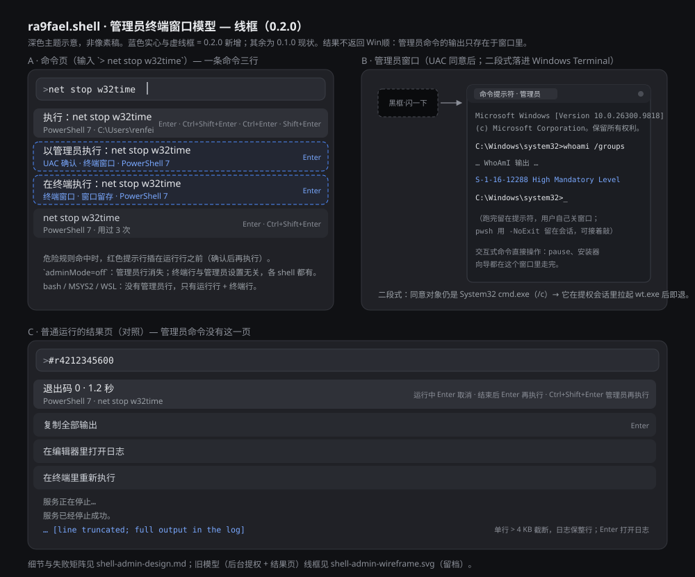
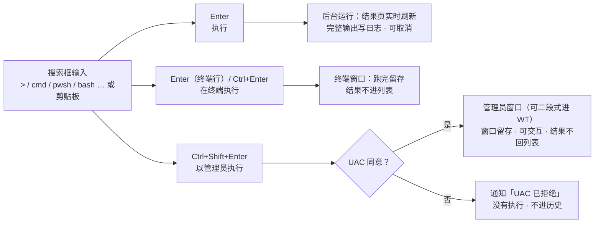

# 命令执行（`ra9fael.shell`）

> **简体中文（默认）** · [English](README.en.md)
>
> Win顺 默认使用中文界面，也自带英文模式。因此中文说明放在 `README.md`，
> 英文说明放在 `README.en.md`，两份内容保持一致，可互相跳转。

在 Win顺 搜索框里执行 shell 命令：手动输入，或者直接执行剪贴板里的内容。
支持 cmd、PowerShell 7、Git Bash、MSYS2、WSL 和自定义 shell。命令在后台运行，
输出实时刷新在结果列表里；按 Ctrl+Enter 可以在终端里打开执行；cmd 和
PowerShell 的命令还可以经 UAC 确认后以管理员执行（Ctrl+Shift+Enter）。插件本身
是 C++ 常驻 exe，没有自己的窗口。



## 安装

1. 从 [最新 Release](https://github.com/ra9fael/winshun-shell/releases/latest)
   下载 `ra9fael.shell-<version>.wsplugin`。可选：用旁边的 `.sha256` 文件核对
   SHA-256（`Get-FileHash <file> -Algorithm SHA256`）。
2. 在 Win顺 里打开 **设置 → 插件 → 已安装 → 添加插件 → 压缩包（.zip / .wsplugin）**，
   选中该文件。

本插件是原生 exe 包。Win顺 0.22.0 起插件库按 **未审核的原生插件**
（`unreviewed-native`）收录社区 exe 包，所以它需要 Win顺 0.22.0 或更新
（清单里的 `minWinShun` 声明了这一点），安装和每次更新都会要求确认。
3. 从本地安装包安装的插件**不会自动启用**。请在列表里打开开关；启用这一步就是你
   在确认它申请的权限（见 [权限与数据](#权限与数据)）。

**更新：** 用同样方式安装新版的 `.wsplugin`。Win顺 认出是同一个 id，会先询问是否
替换旧版本，并保留插件的数据目录。

**卸载：** 在 **设置 → 插件 → 已安装** 里移除。卸载会结束插件进程和它带起来的
子进程；后台还在跑的命令会一起终止。

本插件是原生 exe，不会出现在 Win顺 应用内的插件库里（社区索引只收脚本插件）。
本仓库的 Release 是唯一的分发渠道。

## 从源码构建

环境要求：Windows 10/11 x64、CMake 3.21+，以及 Visual Studio 2022 及以上（MSVC）
或 MinGW-w64 GCC 13+。打包需要 Python 3.10+。

```powershell
cmake -S . -B build -A x64                 # MSVC；MinGW 用 -G "MinGW Makefiles"
cmake --build build --config Release       # 在 plugin.json 旁边生成 shell.exe
ctest --test-dir build -C Release --output-on-failure
python tools/package.py                    # dist/ra9fael.shell-<version>.wsplugin
```

本地构建如何直接在 Win顺 里运行，以及测试和发版流程，见
[CONTRIBUTING.md](CONTRIBUTING.md)。

## 命令

一个 shell 一个关键词。关键词后加空格进入关键词模式，再输入命令。

| 关键词 | 示例 | shell |
|---|---|---|
| `>` | `> git status` | 默认 shell（设置 `defaultShell`，`auto` 时按 pwsh → PowerShell 5.1 → cmd 尝试） |
| `cmd` | `cmd dir` | cmd（`%ComSpec%`） |
| `pwsh` | `pwsh Get-Process` | PowerShell 7 |
| `bash` | `bash ls -la` | Git Bash |
| `msys` | `msys uname -a` | MSYS2（设置 `msysRoot`、`msysEnv`） |
| `wsl` | `wsl uname -a` | WSL 默认发行版 |

### `>` 的额外语法

| 输入 | 作用 |
|---|---|
| `> ls -la` | 用默认 shell 执行 |
| `> @` | 列出所有可用的 shell（含自定义 shell） |
| `> @nu ls` | 用自定义 shell `nu` 执行 `ls` |
| `> #` | 最近一次运行的结果页；`> #r42` 是指定的那一次 |
| `> `（只加空格） | ① 打开默认 shell 的终端；② 执行剪贴板内容；③ 正在运行和刚结束的命令；④ 历史（含所有 shell 的记录，每条标出 shell 名字） |

`cmd #`、`bash #` 等其他关键词同样支持 `#` / `#r42` 查看结果页。`#` 在
bash、pwsh 里是注释，单独执行没有意义，不会和真实命令冲突。

按 Enter 执行历史里的一条时，用这条记录原来的 shell；剪贴板执行的命令默认
不进历史（设置 `saveHistory`）。

### 剪贴板执行与确认

关键词后加空格、且剪贴板里是文本（非空、不超过 64 KB）时，列表会出现
「执行剪贴板内容」一行，悬停显示全文。第一次 Enter **不执行**，而是换成确认页：
确认行、内容预览（最多 20 行），命中危险规则时在最前面多一条警告行。再次 Enter
才真正执行。

`clipboardConfirm` 设置控制确认时机：`always`（默认）、`multiline`（只有多行或
命中危险规则时）、`never`。手动输入的命令不需要确认，Enter 直接执行。

**危险规则只做提示，不拦截**。本插件不做任何「这条命令是否安全」的判断：

- 下载后直接执行：`iex`、`Invoke-Expression`、`| sh`、`| bash`、`curl … |`、`iwr … |`
- 删除和格式化：`rm -rf`、`Remove-Item -Recurse`、`del /s`、`rd /s`、`format`、`diskpart`
- 改系统：`reg delete`、`bcdedit`、`Set-ExecutionPolicy`
- 内容里有不可见字符（零宽字符、改文字方向的 `U+202E` 之类、控制字符）：
  确认页会把这些字符显示成 `<U+202E>`，一眼能看出「复制来的命令」被篡改过。

### 自定义 shell

设置 `customShells`（一行文本，多条用 `|` 分隔）：

```text
nu = C:\tools\nu\nu.exe -f {script} | py = py -3 - ;ext=.py
```

- `名字=程序 参数…`；参数里 `{script}` 是脚本路径，`;ext=.xx` 指定脚本扩展名。
- 程序必须写**已存在的绝对路径**，插件不从数据文件夹加载程序。

### 以管理员执行

cmd 和 PowerShell 7 / 5.1 的命令页多两条入口（设置 `adminMode` 为 `off` 时都不出现；
Git Bash、MSYS2、WSL 和自定义 shell 没有）：

- 运行行的动作条多一个 **Ctrl+Shift+Enter —— 以管理员执行**；
- 运行行下方一条独立行「以管理员执行：<命令>」（副标题 `UAC 确认 · 终端窗口 · <shell>`），
  **Enter** 触发，纯键盘可达；历史行同样带 Ctrl+Shift+Enter。

触发后弹一次 UAC，确认的是**系统自己的 `C:\Windows\System32\cmd.exe`**——命令文本
不进命令行，写在脚本文件里。同意后打开一个**可见的管理员终端窗口**：输出就在
窗口里、有真实输入、命令跑完窗口留着（cmd 留在提示符，PowerShell 用 `-NoExit`
留在会话），交互式命令（`pause`、安装器向导）直接在窗口里操作。结果**不返回
Win顺**——没有结果页、没有日志文件，插件只发一条通知报告打开/拒绝/失败。
插件不声明 `elevated` 权限，宿主也不会替插件提权；点不点 UAC 都由用户。

为什么是窗口：提权进程进不了插件的作业、不能取消、插件随时可能被宿主回收
（空闲、名额驱逐、崩溃击杀），任何「把结果搬回列表」的机制都靠不住；窗口拥有
进程，Win顺 退出它照常跑完，问题整类消失。代价是输出不能从插件复制/搜索、
退出码不进历史——需要管理员的命令本来就在窗口里做更自然。

管理员窗口的宿主由 `adminTerminal` 设置决定（默认 `auto` 跟随 `terminal`；
`wt` 永远二段式，`conhost` 永远直开）。系统级「默认终端应用程序」设置帮不上
忙——它只对普通权限的控制台生效，**提权窗口仍由 conhost 宿主**（2026-11-08
实测：任务管理器勾「以系统管理特权创建」运行的 cmd 同样是 conhost）。所以
二段式（落进 Windows Terminal）只在 `adminTerminal` 解析为 wt 时走：同意对象
仍是 System32 cmd.exe，但用 `/c`——提权 cmd 在会话里拉起 wt.exe 新窗口跑脚本
后立即退出，只有 WT 窗口留下；代价是外层黑框会闪一下。二段式没走成时
（设了 `conhost`、`terminal` 不是 wt、或 wt 没装），提权 cmd 自己开控制台
（conhost 形态），窗口照样可见、留存。

限制（设计上就有，不是 bug）：

- **UAC 流程一次一条**。弹窗未点时再触发只提示「正在请求管理员权限，请稍候」；
  窗口打开后各自独立，多个管理员窗口可以并存。
- 在 UAC 点「否」：通知「UAC 已拒绝，没有执行」；提权启动失败（如系统策略禁了
  UAC 提示）：通知「无法提权（错误 N）」。这两种情况都没执行任何东西，不进历史。
- Win顺 退出时管理员窗口**不会**跟着退出；它跑完留在那里，由用户自己关。
- 窗口成功打开即记入历史（`saveHistory` 开时）；退出码未知，历史里不显示。

## 动作

动作按固定顺序声明；决定键盘映射的是**顺序**，不是 `key` 字符串。

| 命令 | Enter | Ctrl+Shift+Enter | Ctrl+Enter | Shift+Enter | 菜单（无按键） |
|---|---|---|---|---|---|
| 全部命令 | `execute` —— 后台执行，结果进列表 | `executeAdmin` —— 经 UAC 确认后以管理员执行（仅 cmd / PowerShell，`adminMode=off` 时不出现） | `openTerminal` —— 在终端里执行，执行完不关窗口 | `edit` —— 把命令填回搜索框改一改再执行 | `copyCommand` —— 复制命令；`deleteHistory` —— 从历史里删除 |

交互式命令（`python`、`ssh`、`vim`、要输密码的）走 Ctrl+Enter：终端打开、脚本
就地执行、窗口保留，交互由用户在终端里做；需要管理员权限的命令走
Ctrl+Shift+Enter（见上节），或者同样在终端里自己提权。运行行下方还有一条
独立行「**在终端执行：<命令>**」（副标题 `终端窗口 · 窗口留存 · <shell>`），
**Enter** 直达、所有 shell 都有，与 Ctrl+Enter 是同一能力。

三条执行路径一眼看全：



## 执行与结果

- **查询永远不执行命令**，只有 Enter / Ctrl+Enter 的动作才执行。打字、浏览
  历史、看剪贴板都不会执行任何东西。
- Enter 后搜索框变成 `> #r42` 这样的结果页地址，输出实时刷新；选中行不跳。
- 结果页显示最后 50 行输出（设置 `outputLines`，10–190）。stdout 和 stderr
  按时间顺序合在一起，stderr 用不同图标标出。ANSI 颜色码被去掉，`\r` 覆盖的
  进度条只保留最后一次的内容。
- 完整输出写在日志文件里；截断行的 Enter 打开日志。状态行运行中 Enter 是取消
  （进程树整体结束），结束后 Enter 是再执行一次。
- 内存有界：只保留最近 50 个已结束的运行；单行超过 4 KB 在列表里截断（日志
  保留整行）；一条没有换行的超长输出也不会撑爆读缓冲。插件常驻不退出，这些
  上限保证它不会被宿主因内存或超长输出行杀掉。
- 操作行紧跟着状态行、在输出行**前面**：`复制全部输出` · `在编辑器里打开日志` ·
  `在终端里重新执行` · `加入历史`（只在剪贴板执行的结果页出现）——不用翻到长输出
  的末尾就能用到。
- 同时最多 4 个命令在跑，再多会提示并发已满。管理员窗口不占这个名额（进程归
  窗口），UAC 请求一次一条。按 Esc 收起搜索框命令照样跑，结束时发系统通知
  （正文只写退出码和用时，不写命令和输出）。
- **编码**：输出按行先试 UTF-8，不合法的行退回系统 OEM 代码页；`wsl.exe`
  自己的报错是 UTF-16LE，也能解。
- 每次执行的命令都写成脚本文件交给 shell（不用 `-c "..."`，引号、`%`、`$`
  不会被转义弄坏；多行的剪贴板脚本原样运行）。cmd 脚本是 UTF-8 + CRLF +
  `chcp 65001`；bash 系是 UTF-8 无 BOM + LF；PowerShell 5.1 的脚本带 BOM。
  后台执行的脚本在结束后删除，终端打开的保留，按日志规则清理。

## 设置

| 键 | 类型 | 默认值 | 含义 |
|---|---|---|---|
| `defaultShell` | text | `auto` | `>` 用的 shell：`auto` 或上表的名字，或自定义 shell 的名字 |
| `workDir` | folder | 空（用户主目录） | 每次执行的起始目录 |
| `pwshPath` | file | 空（自动检测） | pwsh.exe 完整路径 |
| `gitBashPath` | file | 空（自动检测） | Git 自带的 bash.exe |
| `msysRoot` | folder | `C:\msys64` | MSYS2 安装目录（用其中的 `usr\bin\bash.exe`） |
| `msysEnv` | choice | `UCRT64` | `MSYSTEM` 的值：`MSYS` / `UCRT64` / `MINGW64` / `CLANG64` |
| `customShells` | text | 空 | 自定义 shell，见上文 |
| `terminal` | choice | `wt` | Ctrl+Enter 用的终端：`wt`（没装退回 conhost）/ `conhost` / `mintty`（只对 Git Bash 和 MSYS2 有效） |
| `clipboardConfirm` | choice | `always` | 剪贴板内容的确认时机 |
| `adminMode` | choice | `ask` | 以管理员执行：`ask` 允许（入口出现，弹 UAC），`off` 关闭（所有管理员入口不出现） |
| `adminTerminal` | choice | `auto` | 管理员窗口的宿主：`auto` 跟随 `terminal`（wt 时二段式进 Windows Terminal），`wt` 永远二段式（wt 没装回退控制台），`conhost` 永远用提权 cmd 自己的控制台。只管管理员窗口，Ctrl+Enter 仍看 `terminal` |
| `outputLines` | number | 50 | 结果页显示最后几行输出（10–190） |
| `notifyAfterSec` | number | 10 | 运行超过几秒才发通知；搜索框开着且用时短于它时不通知 |
| `saveHistory` | bool | `true` | 是否记录历史 |

## 权限与数据

`runtime.sandbox` 为 `normal`（strict 是低完整性，写不了用户目录，命令会在
错的地方失败）。manifest 声明四个权限：

| 权限 | 原因 |
|---|---|
| `processes` | 启动 shell 子进程；没有它，作业限制只允许 1 个进程，`CreateProcess` 直接失败 |
| `clipboard:read` | 「执行剪贴板内容」读取剪贴板文本 |
| `clipboard:write` | 结果页的「复制全部输出」和输出行的复制 |
| `notifications` | 命令结束后发系统通知，点通知回到结果页 |

子进程运行在插件的作业（job object）里：插件被停用或崩溃时，Win顺 结束作业，
子进程一起结束，不会留下孤儿进程。插件主动取消一次运行时，结束的是自己为这次
运行建的嵌套作业。**例外是管理员窗口**：提权进程进不了普通权限进程的作业，
也不接受插件的信号——它归窗口所有，Win顺 退出照常跑完，插件不观察也不干预。

本插件**执行任意命令**，这是它的本职；`processes` 权限在启用时由 Win顺 列出
让用户确认。插件不检查命令是否安全，危险规则只是提示。不声明 `elevated`，
宿主不替插件提权。管理员执行是插件对自己启动的子进程请求提权：UAC 弹窗的
确认对象固定是系统的 `C:\Windows\System32\cmd.exe`，命令文本只存在于插件数据
目录里的脚本文件中，不进命令行；每次提权都要用户在 UAC 弹窗上亲自点允许
（`adminMode=off` 可整体关闭）。

数据都在 `WS_DATA_DIR`：

| 路径 | 内容 | 清理规则 |
|---|---|---|
| `history.json` | 历史命令（含 shell、最近退出码），最多 200 条，相同 shell + 相同命令合并 | `saveHistory` 关掉后不写 |
| `runs\<id>.log` | 完整输出，单文件最大 10 MB（超出截断并注明） | 保留最近 50 个或 7 天内的，取较少的一边 |
| `runs\<id>.<扩展名>` | 脚本文件 | 后台执行的结束后马上删；终端打开的和管理员窗口的（`t<时间戳>.<扩展名>`）按日志规则清理 |

`history.json` 读出来当作不可信输入：类型不对、超长的条目丢掉，解析失败改名
`.bad` 后从空开始。历史里可能有密码、token，可以用 `saveHistory` 关掉，单条
删除用 `deleteHistory` 动作。插件日志只记运行 id、shell、退出码、用时，不记
命令内容和输出。不上传任何用户数据：没有网络调用。

## 构建与运行时依赖

- Windows，支持 C++ 常驻插件协议的 Win顺（JSON-RPC 2.0，stdio 上每行一条
  UTF-8 消息）。
- C++17 编译器。MSVC（静态 CRT，`/utf-8`）或 MinGW-w64（静态链接）均可。
  不用 Qt、不用第三方库、不需要运行时 DLL。
- `winshun.h` 从 `WinShun/src/plugins-sdk/winshun.h` 逐字节复制，插件因此
  自包含。
- 构建产物直接输出到本目录，因为 `plugin.json` 把 `shell.exe` 指定为
  `runtime.program`。构建命令见 [从源码构建](#从源码构建)。

## 验证

- 纯逻辑单元测试 151/151 通过（输入解析、自定义 shell 解析、脚本生成、
  WSL 路径转换、输出解码、危险规则、历史、清理、管理员窗口包装行、输出行截断）。
- 用真 shell 做的 stdio 协议集成测试 19/20 通过（cmd / pwsh / bash / msys 的
  执行与退出码、运行中逐行刷新、取消进程树、剪贴板确认页与危险警告、历史、
  并发上限、空状态、`@` 列表、`#r` 结果页等；`wsl` 一项因本机没有可用的
  发行版未验）。逐项结果记录在设计文档第 9 节。
- Ctrl+Enter 三种终端（wt / conhost / mintty）的打开与执行验证通过。
- 管理员执行改为提权终端窗口后，真实宿主（wsbench）验证了入口渲染、设置开关、
  普通路径回归，以及 3 MB 无换行输出的上限冒烟（日志一字节不丢、插件存活）；
  真机 UAC 的同意 / 拒绝 / 交互 / 留存场景属手工验收，清单见
  [shell-admin-verification.md](../shell-admin-verification.md)。

**尚未验证**：Win顺 GUI 里的关键词冲突（`>`、`cmd` 等与内置结果）、↓ 选择
行为、通知点击、深色/浅色主题下的图标，以及真实 UAC 弹窗的全链路（见
shell-admin-verification.md 的手工步骤）。

## 失败处理

- shell 没检测到：只有一行「未检测到 Git Bash」（Enter 打开插件设置），不会
  静默退回别的 shell。
- 命令不存在、退出码非零：退出码和 stderr 都如实显示，不编造成功。
- 并发已满、剪贴板太长（> 64 KB）、自定义 shell 名字不存在：一行明确的提示。
- 所有诊断信息走 stderr（`plugins.log`），stdout 只承载 JSON-RPC 行。
  `timeoutMs` 为 1500，但协议线程从不等子进程，命令跑多久都不受它限制。

## 分发与版本

`runtime.program` 是原生可执行文件。社区仓库的 `plugin.schema.json` 把
`runtime.program` 限制为解释器和官方白名单，`CONTRIBUTING.md` 也排除 exe / DLL
提交，因此本插件由**自己的仓库以 `.wsplugin` 包分发**，用户导入 Win顺
（见 [安装](#安装)）。不要向 `WinShun-plugins` 提源码 PR。
`tools/package.py` 从 git 跟踪的文件加上构建好的 `shell.exe` 打包，所以
`build/`、日志和任何未跟踪内容都不会进入发布包。每次发布都要递增 `version`；
见 [CONTRIBUTING.md](CONTRIBUTING.md)。

## 许可证

MIT，见 [LICENSE](LICENSE)。发布历史见 [CHANGELOG.md](CHANGELOG.md)。

---

简体中文（默认） · [English](README.en.md)
